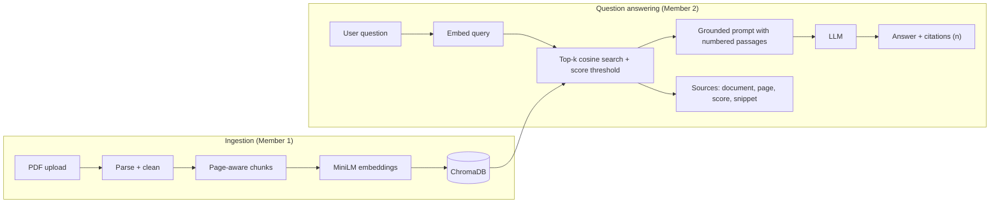

# Architecture

## Hallucination controls
1. System prompt restricts the model to the numbered passages and defines an exact "not found" reply.
2. Passages below `min_score` (0.20 cosine) are dropped; if nothing remains the LLM is **not called**.
3. Low temperature (0.1).
4. Every answer ships with document name, page number, similarity score and snippet; sources the model actually cited are flagged.
5. Passage text is declared to be data, not instructions (mitigates prompt injection from documents).

## Known limitations / future work
* Scanned PDFs need OCR (not included).
* Follow-up questions are answered independently (no query rewriting from chat history).
* Tables and figures are extracted as plain text only.
* Possible upgrades: cross-encoder re-ranking, hybrid BM25 + vector search, streaming answers.
